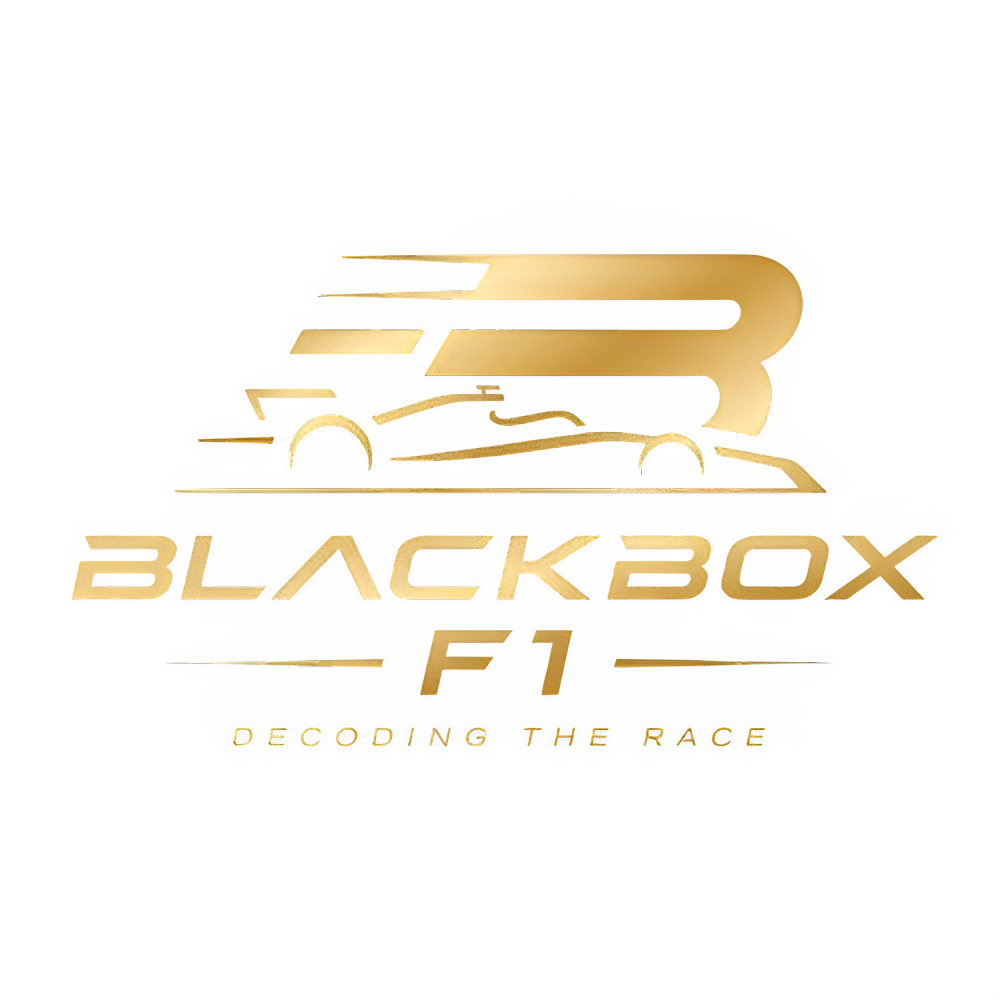

<p align="center">
  
</p>

<h1 align="center">Blackbox-F1</h1>

<p align="center">
  <strong>Consola de telemetría, cronometraje y transmisiones de Fórmula 1 en tiempo real, diseñada en español para usarse como segunda pantalla junto a la televisión.</strong>
</p>

<p align="center">
  
  
  
  
  
  
</p>

---

## 🏁 ¿Qué es Blackbox-F1?

Cuando mirás una carrera o clasificación por televisión o streaming, la transmisión oficial solo muestra una parte mínima de lo que pasa en pista: el director de cámaras elige qué auto enfocar y muchas de las peleas por el medio del pelotón o las vueltas rápidas quedan afuera.

**Blackbox-F1** convierte cualquier celular, tablet o monitor secundario en una pared de boxes (*pit-wall*) completa. Te da acceso al paquete oficial de datos al milisegundo, tiempos de sector, telemetría de pedales, radar meteorológico y control de retraso (*TV Sync*) para que los números avancen al mismo ritmo exacto de tu televisor sin arruinarte finales con spoilers.

---

## 🎛️ Funcionalidades del Cockpit

### 1. Telemetría en Vivo (`/dashboard`)
* **Cronometraje al milisegundo (0.001s):** Tiempos de vuelta actuales, personales y deltas en tiempo real.
* **Microsectores y Sectores Oficiales:** Resaltado de récord absoluto (*overall purple*), récord personal de vuelta (*green*) y sectores regulares (*yellow*).
* **Gestión de Neumáticos:** Compuestos activos (Blando, Medio, Duro, Intermedio, Lluvia extrema), número de vueltas de vida de la goma y registro de paradas en boxes (*pit stops*).
* **Métricas de Monoplaza:** Tacómetro de revoluciones por minuto (RPM), velocímetro en km/h o mph, marcha engranada y estado del DRS (disponible o activado).
* **Incidentes FIA en Pantalla:** Alertas directas de Dirección de Carrera con banderas amarillas, verdes, rojas, Auto de Seguridad (*Safety Car*) y *Virtual Safety Car* (VSC).
* **Radios de Equipo en Directo:** Escucha de mensajes de voz oficiales entre ingenieros y pilotos con reproducción automática configurable para pilotos favoritos.

### 2. Sincronizador de Retraso (TV Sync)
Las transmisiones deportivas por cable o plataformas como Disney+, Star+ o F1TV tienen demoras variables que van de 10 a 60 segundos. 
* Un control deslizante milimétrico permite retrasar el flujo de datos entrante en un buffer local.
* Los tiempos, posiciones y gráficos quedan perfectamente sincronizados con la imagen que estás viendo en tu pantalla.

### 3. Modo Parque Cerrado (`ParcFerme`)
Cuando los motores están apagados entre sesiones o durante la semana previa al Gran Premio:
* Muestra la grilla oficial clasificada de la última ronda disputada.
* Selector de sesión fluido en oro líquido (*FP1*, *FP2/SQ*, *FP3/Sprint*, *Qualy*, *Carrera*).
* Trazado del circuito en alta resolución táctil con estadísticas de longitud, curvas y zonas de DRS.
* Micro-interacciones reactivas con ensanchamiento y resplandor del color oficial de cada escudería al pasar el cursor o pulsar una fila.

### 4. Archivo Histórico y Campeonatos FIA (`/dashboard/standings`)
* **Mundial de Pilotos y Constructores:** Tabla de puntos de la temporada actual y archivo histórico completo desde **1950 hasta 2026**.
* **Temporada 2026 oficial:** Seguimiento de carreras disputadas y rondas por correr según el calendario de la FIA.
* **Fichas Inmersivas de Pilotos y Equipos:** Monos de carrera oficiales, biografías, fotos reales de grilla, desglose de victorias, poles y podios, con adaptación cromática al color de la escudería seleccionada.
* **Visualización Dinámica:** Barras de rendimiento y contadores numéricos animados a alta velocidad.

### 5. Feed Satelital y Transmisiones (`/streams`)
* Múltiples fuentes de video integradas con redundancia ante caídas de servidor: **Fox Sports AR, Disney+, DAZN F1, ESPN 2** y cámara **Onboard de Franco Colapinto**.
* **Candado de seguridad automático:** Se desbloquea automáticamente 15 minutos antes de que empiece la sesión oficial en pista (o mediante triple clic manual).
* Conmutación entre servidores (DaddyLive, StreamTP, NTV, DeporteLibre, Embed) con un solo clic y soporte de pantalla completa sin saltos forzados.

### 6. Radar Meteorológico y Pista (`/dashboard/weather`)
* Radar Doppler de precipitaciones superpuesto en tiempo real sobre la ubicación geográfica del circuito.
* Lecturas ambientales de sensores en pista: temperatura del asfalto, temperatura del aire, porcentaje de humedad, presión atmosférica y rosa de los vientos con dirección y velocidad en nudos/km/h.

### 7. Ajustes y Personalización (`/dashboard/settings`)
* **Cuatro Temas Visuales:**
  * 🏆 **Oro 24K Blackbox Clásico:** La estética ámbar distintiva sobre carbono.
  * ⚡ **Oro Neón Ultra-Glow:** Dorado electrizante de alta luminosidad para carreras nocturnas.
  * 💎 **Oro Rosa / Champagne:** Matiz cobrizo cálido de acabado metálico.
  * 🌙 **Modo OLED:** Fondo negro puro (`#000000`) de contraste extremo que reduce el consumo de batería en pantallas OLED y AMOLED.
* **Modo Segunda Pantalla (Wake Lock):** El sistema mantiene la pantalla encendida de forma permanente en segundo plano mientras la app está abierta, evitando que el dispositivo se bloquee por inactividad.
* **Respuesta Háptica Táctil:** Micro-vibraciones mecánicas al tocar botones, pestañas y pilotos en celulares y tablets compatibles.
* **Densidad de Grilla:** Selector entre *Modo Confort* (filas amplias) y *Modo Pit-Wall* (filas compactas para ver los 20 autos sin necesidad de scrollear).
* **Formato de Tiempos:** Alterná entre ver el intervalo con el auto de adelante o la diferencia acumulada respecto al líder P1.

---

## 🏗️ Arquitectura Técnica

El proyecto combina un frontend moderno en Next.js con servicios backend de ingesta y procesamiento de alta velocidad:

```
├── dashboard/               # Frontend Next.js 16 (App Router), React 19, Tailwind CSS v4, Zustand
├── realtime/                # Microservicio en Rust para WebSocket y procesamiento en milisegundos
├── api/                     # Servicio de datos históricos, sesiones y calendario
├── shared/                  # Estructuras de datos y tipos compartidos
└── compose.yaml             # Orquestación de contenedores Docker para desarrollo y producción
```

### Stack Frontend
* **Framework:** Next.js 16 (Webpack / Turbopack compatible) con React 19.
* **Estilos:** Tailwind CSS v4 con variables CSS dinámicas para los temas de oro.
* **Animaciones:** Motion (Framer Motion) para transiciones fluidas de grilla y modales.
* **Manejo de Estado:** Zustand con persistencia local (`localStorage`) para ajustes y configuraciones de usuario.
* **Mapas:** MapLibre GL con capas satelitales y trazos vectoriales de circuito.

---

## 🚀 Instalación y Desarrollo Local

### Opción A: Solo Frontend (Recomendado para diseño y UI)

Si querés probar la interfaz conectándote a las APIs públicas:

```bash
# 1. Clonar el repositorio
git clone https://github.com/FocusFV/BlackBox-F1.git
cd BlackBox-F1/dashboard

# 2. Instalar dependencias
npm install

# 3. Iniciar el servidor de desarrollo
npm run dev
```

La aplicación quedará disponible en [http://localhost:3000](http://localhost:3000).

---

### Opción B: Stack Completo con Docker Compose

Para correr el frontend junto con los microservicios de backend en Rust:

```bash
# Desde la raíz del proyecto
docker compose up -d
```

Servicios levantados:
* **Dashboard Web:** `http://localhost:3001`
* **Realtime Service (Rust):** `http://localhost:4200`
* **API Service (Rust):** `http://localhost:4020`

---

## 📱 Diseñado para Segunda Pantalla

Blackbox-F1 está pensado para colocarse al lado del televisor durante las carreras:
* **Optimizado para pantallas táctiles:** Botones con buena zona de toque, soporte háptico y navegación sin retrasos.
* **Consumo eficiente:** En modo OLED, los píxeles negros se apagan por completo para extender la duración de la batería de tablets y celulares.
* **Cero bloqueos:** El Wake Lock evita que tengas que tocar la pantalla cada 30 segundos para que no se apague.

---

## 📄 Nota Legal / Disclaimer

Este proyecto es una herramienta independiente y comunitaria desarrollada por fanáticos del automovilismo con fines informativos y educativos. No está afiliado, respaldado, asociado ni patrocinado por Formula One Group, FIA, ni ninguna de sus empresas subsidiarias. 

F1, FORMULA ONE, FORMULA 1, FIA FORMULA ONE WORLD CHAMPIONSHIP, GRAND PRIX y las marcas relacionadas son marcas comerciales registradas propiedad de **Formula One Licensing B.V.**
